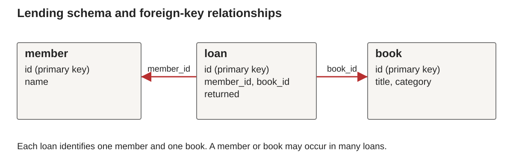
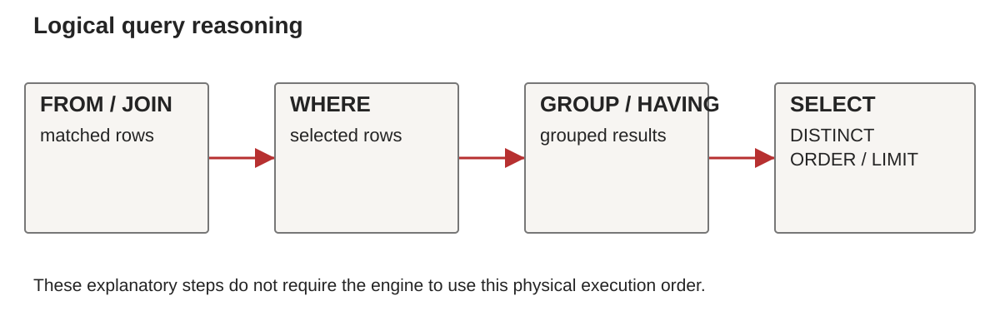

# Week 7: SQL and Relational Programming

BS0030 Programming Languages, Fall 2026

## Continuity

Logic programming searched for substitutions. SQL describes tabular results and delegates physical execution to a query engine.

## SQL and Relational Programming

Week 7, BS0030 Programming Languages

**A query specifies a result over related tables.**

## Retrieval: relations and search

```prolog
eligible(X) :- student(X), passed(X, bs0030).
```

- What substitution answers the query?
- Why can goal order affect termination?
- Which choices might a database engine make for us?

## Learning outcomes

- Read a schema and identify keys and relationships.
- Write selections, joins and grouped queries.
- Explain duplicates, NULL and missing matches.
- Distinguish logical results from physical execution.
- Compare SQL with functional and logic programming.

## A small lending dataset

| Table | Columns |
| --- | --- |
| member | id, name |
| book | id, title, category |
| loan | id, member_id, book_id, returned |

`returned = 0` means an active loan.
`returned = 1` means a completed loan.

## Keys and relationships



One member may have many loans.
Each loan refers to one member and one book.

## Relations and SQL results

The mathematical relational model uses sets of tuples.

SQL commonly retains **duplicate rows** in query results.

```sql
SELECT category FROM book;
SELECT DISTINCT category FROM book;
```

## Selection and projection

```sql
SELECT id, title
FROM book
WHERE category = 'computing';
```

- `WHERE` chooses rows.
- The select list chooses result columns.

## Logical query reasoning



This is a **reasoning model**, not a required physical plan.

## Ordering and limiting

```sql
SELECT id, title
FROM book
ORDER BY title, id
LIMIT 2;
```

Without `ORDER BY`, row order has no guarantee.
A tie-breaker makes the chosen subset predictable.

## Inner joins

```sql
SELECT m.name, b.title
FROM loan AS l
JOIN member AS m ON m.id = l.member_id
JOIN book AS b ON b.id = l.book_id
WHERE l.returned = 0
ORDER BY m.id, b.id;
```

## Join cardinality

One member with three loans produces three joined rows.

```sql
SELECT m.name
FROM member AS m
JOIN loan AS l ON l.member_id = m.id;
```

What does one result row mean here?

## Grouping and aggregation

```sql
SELECT member_id, COUNT(*) AS active_count
FROM loan
WHERE returned = 0
GROUP BY member_id
ORDER BY member_id;
```

Each output row describes one member's active loans.

## WHERE and HAVING

```sql
SELECT member_id, COUNT(*) AS n
FROM loan
WHERE returned = 0
GROUP BY member_id
HAVING COUNT(*) >= 2;
```

`WHERE` filters rows. `HAVING` filters groups.

## Left joins preserve missing matches

```sql
SELECT m.id, m.name, l.id AS loan_id
FROM member AS m
LEFT JOIN loan AS l
  ON l.member_id = m.id AND l.returned = 0
ORDER BY m.id, l.id;
```

Cara remains, with a NULL loan identifier.

## NULL and three-valued logic

```sql
SELECT id, name FROM member
WHERE name IS NULL;
```

- `NULL = NULL` evaluates to unknown.
- `WHERE` keeps rows for which its condition is true.
- `IS NULL` tests for the marker directly.

## Counting zero correctly

```sql
SELECT m.id, m.name, COUNT(l.id) AS n
FROM member AS m
LEFT JOIN loan AS l
  ON l.member_id = m.id AND l.returned = 0
GROUP BY m.id, m.name
ORDER BY m.id;
```

`COUNT(l.id)` gives **2, 1, 0**.

## An outer-join trap

```sql
SELECT m.name, l.id
FROM member AS m
LEFT JOIN loan AS l ON l.member_id = m.id
WHERE l.returned = 0;
```

Will Cara appear?
Where should the active-loan condition go?

## EXISTS expresses a membership question

```sql
SELECT m.id, m.name
FROM member AS m
WHERE EXISTS (
  SELECT 1 FROM loan AS l
  WHERE l.member_id = m.id AND l.returned = 0
)
ORDER BY m.id;
```

## NOT EXISTS finds absence of a match

```sql
SELECT m.id, m.name
FROM member AS m
WHERE NOT EXISTS (
  SELECT 1 FROM loan AS l
  WHERE l.member_id = m.id AND l.returned = 0
);
```

Expected member: **Cara**.

## A named intermediate result

```sql
WITH active AS (
  SELECT * FROM loan WHERE returned = 0
)
SELECT book_id, COUNT(*) AS n
FROM active
GROUP BY book_id;
```

A CTE names a query result inside one statement.

## Execution plans and indexes

```sql
EXPLAIN QUERY PLAN
SELECT * FROM loan WHERE member_id = 1;
```

An index may reduce search work.
The engine still must preserve the query's meaning.

## SQL dialect and type behavior

- SQLite normally uses flexible typing and affinities.
- SQLite also offers `STRICT` tables.
- Other engines enforce different type rules.
- Portable queries avoid permissive bare aggregate columns.

## Comparing computational models

| Model | Program describes | Runtime performs |
| --- | --- | --- |
| Clojure | value transformations | function evaluation |
| Prolog | facts and rules | ordered proof search |
| SQL | result over relations | selected query plan |

## Practical: a relational report

[Week 7 lab](../../labs/week07/README.md)

- Build the supplied SQLite fixture.
- Predict results before running queries.
- Include zero counts and repeated-event cases.
- Explain a join bug and its repair.
- Complete A4 with reproducible query evidence.

## Midterm retrieval checklist

- Grammar, AST, scope and types.
- Pure functions, closures and evaluation.
- Unification, recursive relations and search.
- Joins, grouping, duplicates and NULL.
- An explanation of each model's trade-offs.

## Further study

- [SQLite SELECT](https://www.sqlite.org/lang_select.html): joins and grouping.
- [SQLite aggregates](https://www.sqlite.org/lang_aggfunc.html): COUNT and NULL.
- [PostgreSQL query tutorial](https://www.postgresql.org/docs/current/tutorial-sql.html): compare a server dialect.
- Sebesta 12e Chapter 16: compare declarative models.

Exercise: explain why a join can duplicate a member.

## Further reading in Sebesta

Sebesta 12e Chapter 16 for the declarative comparison. SQL is a course supplement, not a dedicated chapter in this edition.

## Next unit

Week 8 assesses Weeks 1–7. Practise tracing and explaining these models before beginning Kotlin in Week 9.
