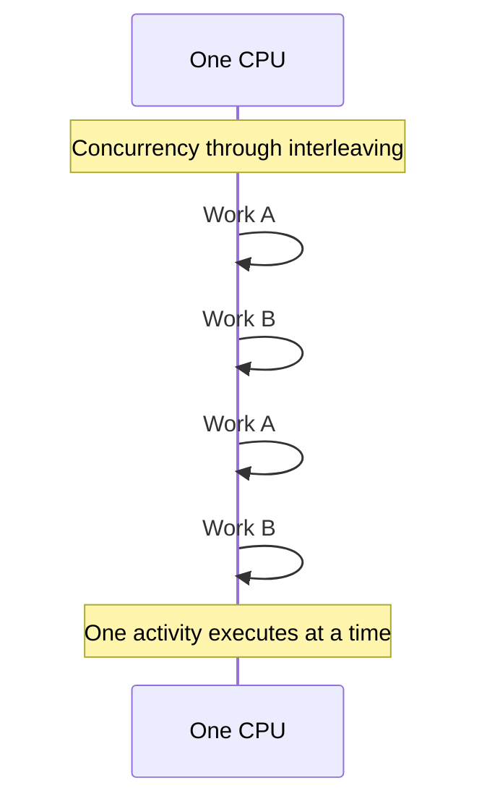
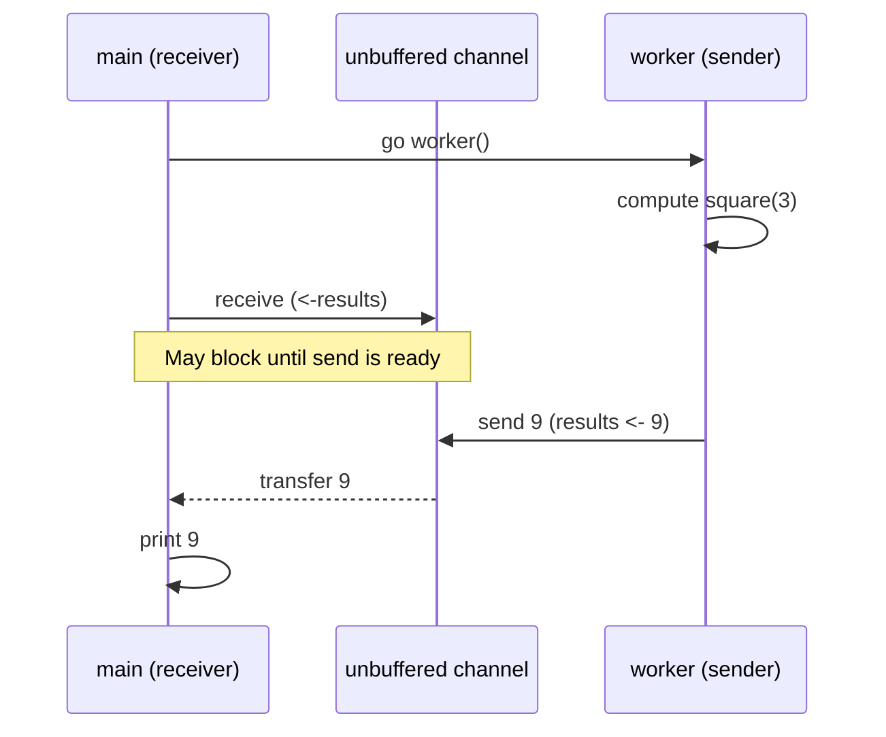
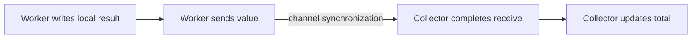

# Understanding Goroutines in Go: From Fundamentals to Concurrent Program Design

**BS0030 Programming Languages — Week 11 supplementary tutorial**  
**Riga Business School, Riga Technical University · Fall 2026**  
**Level:** second-/third-year bachelor; basic Python knowledge assumed  
**Status:** optional deeper reading; the assessed Week 11/12 requirements remain in the lab and Moodle

> **Reading route.** Sections 1–5 establish the foundations (about 20–30 minutes); sections 6–12 develop practical concurrency (another 35–50 minutes); sections 13–17 are an optional deeper investigation (another 30–45 minutes). Work through the examples in order. If you are short on time, read sections 1–8 and return to the remainder after completing the [Week 11 practical](../../labs/week11/README.md).

**Prerequisites:** functions, loops, local variables, collections and basic command-line use. We explain Go syntax when it first appears. Examples use only the standard library and are compatible with the Go environment provided for Weeks 11–12; no third-party packages are needed.

**Learning outcomes:** explain concurrency versus parallelism; launch goroutines; coordinate a result with a channel; predict blocking and completion; preserve input order when results arrive in another order; distinguish data races, deadlocks and goroutine leaks; compare channels, `sync.WaitGroup` and `sync.Mutex`; describe elementary *happens-before* relationships.

## 1. Why do programs need concurrency?

A **sequential** program completes one step before starting the next. This model is easy to reason about, and is often the right design. Yet many real applications must manage partially independent activities: a web server handling requests, a desktop application remaining responsive while reading a file, or a service making several network requests. Instead of waiting for one activity to finish before even beginning another, we can structure the program so activities may *make progress independently*.

Concurrency is particularly useful when work is **I/O-bound**: one operation may wait for a disk or network while another makes progress. **CPU-bound** computations can also benefit if they are sufficiently independent and can execute on multiple processors. Neither benefit is automatic: creating tasks, transferring data and synchronizing access have costs. Launching hundreds of goroutines to multiply a handful of integers would generally be *more complex*, not an optimization. The reason we use squares in this tutorial is that their mathematical result is easy to verify while we study the execution model.

Think back to Week 10's Kotlin examples. An object can encapsulate its fields, but encapsulation by itself does not prevent two callers from executing at overlapping times. Go makes the *coordination* a visible part of the design.

## 2. Concurrency is not parallelism

- **Concurrency** is the *structure* of a program that manages multiple activities capable of making independent progress.
- **Parallelism** is *simultaneous execution* of work, typically on different processor cores.

On one processor, a scheduler may interleave A and B without executing them simultaneously. On two cores, A and B may truly overlap in time. Concurrent design makes parallel execution *possible*, not inevitable.



A CPU-intensive program with dependencies may not run faster on multiple cores. A program doing network requests might improve response time through overlap even when only one core runs its Go code at a given instant. Rob Pike's [*Concurrency is not Parallelism*](https://go.dev/blog/waza-talk) is an authoritative conceptual introduction; see also the [Go FAQ](https://go.dev/doc/faq#concurrency).

**Predict:** if two tasks both must wait for a server response, can starting them concurrently reduce elapsed time even without two dedicated CPU cores? **Answer:** potentially yes, because waits can overlap. Whether it does depends on the actual work and external service.

## 3. What exactly is a goroutine?

A **goroutine** is a function executing independently in the same process address space as other goroutines. The keyword `go` starts one. Goroutines are managed by the Go runtime, which schedules many goroutines over a smaller or changing set of operating-system threads. They start with relatively small stacks that can grow when necessary; they are *not* the same thing as operating-system threads, nor are they `Promise` objects returned to a caller.

The ordinary call `square(3)` computes a value and returns it to its caller. In contrast, `go square(3)` begins the call in a new goroutine. It does **not** return a handle or `square`'s return value to the caller. Arguments and the function value are evaluated when the `go` statement is executed; the actual function body runs independently. [Go specification: Go statements](https://go.dev/ref/spec#Go_statements).

### Example 1 — ordinary calls and asynchronous execution

```go
// Save as example01.go, then run: go run example01.go
package main

import "fmt"

func square(n int) int { return n * n }

func main() {
    fmt.Println("ordinary result:", square(3))
    go square(4) // Legal, but the returned 16 is discarded.
    fmt.Println("main continues")
}
```

**Guaranteed:** `ordinary result: 9` precedes `main continues`. **Not guaranteed:** that the new goroutine has finished before the program exits. We cannot observe the discarded result. The process does not keep running merely because another goroutine remains alive after `main` returns.

Go basics in this example: `package main` is executable program code; `func main()` is the entry point; `func square(n int) int` declares a parameter and result type. Compare Python's `def square(n): return n * n`.

### Example 2 — an observable but unordered goroutine

```go
// Save as example02.go and run it repeatedly.
package main

import "fmt"

func main() {
    go fmt.Println("worker")
    fmt.Println("main")
}
```

You might see only `main`, or `worker` and `main` in different orders. Do **not** infer a reliable schedule from a few runs. Also avoid using `time.Sleep(...)` as a substitute for proving that work has finished: a guessed delay is a timing assumption, not a synchronization protocol.

## 4. A channel transfers values and coordinates activities

A **channel** is a typed conduit through which goroutines send and receive values. `make(chan int)` creates an **unbuffered** channel of integers. In `ch <- 9`, the arrow points into the channel; in `value := <-ch`, the arrow points from the channel. Sending to an unbuffered channel requires a corresponding receiver, and receiving requires a corresponding sender. The communication therefore gives us both data transfer and a synchronization event.

### Example 3 — obtain a result safely

```go
// Save as example03.go.
package main

import "fmt"

func square(n int) int { return n * n }

func main() {
    results := make(chan int)
    go func() {
        results <- square(3)
    }()

    answer := <-results // Blocks until a value can be received.
    fmt.Println(answer) // 9
}
```

**Trace:** (1) `main` creates a channel; (2) `go func(){...}()` launches an anonymous function; (3) the worker computes 9; (4) its send and the collector's receive meet; (5) `main` prints the value. Either side may arrive at the communication point first, but the final answer is the same.



**Important distinction:** the channel does not magically protect unrelated shared variables. It orders operations associated with the communication; an unrelated unsynchronized write can still race. See [The Go Memory Model](https://go.dev/ref/mem#Channel_communication).

## 5. Goroutine lifetime and completion are design choices

A `go` statement starts work but does not promise completion. There are several ways to know that work has finished:

1. **Receive the required result**, as in Example 3; this is often the cleanest design when the worker produces a value.
2. **Wait for task completion** using `sync.WaitGroup` when a known group of tasks must finish (section 9).
3. **Receive a closed-channel notification** when a producer has a clear channel-closing protocol (section 10).

Do not substitute a guessed delay, a print statement or the number of goroutines reported by a debugger for a completion protocol. Also distinguish *a goroutine has completed* from *every piece of shared state is safely accessed*. Correct concurrency requires both progress and appropriate synchronization.

## 6. Buffered channels and blocking behavior

`make(chan int, 2)` creates a channel with capacity two. A send may proceed without an immediately waiting receiver **while space remains**. A full channel blocks further sends; an empty open channel blocks receives. A buffer changes the synchronization points; it does not remove the need to design completion correctly.

### Example 4 — capacity changes what may proceed

```go
// Save as example04.go.
package main

import "fmt"

func main() {
    ch := make(chan int, 2)
    ch <- 10
    ch <- 20
    fmt.Println(<-ch, <-ch) // 10 20
}
```

Unbuffered replacement: with `make(chan int)`, the **first send** blocks because no separate receiver can run before `main` reaches its receive. Capacity-one replacement: the **second send** blocks. The printed order is stable here because values from one sender enter and leave this channel in FIFO order, not because all goroutines have deterministic scheduling.

| Channel state | Send | Receive |
| --- | --- | --- |
| Unbuffered, no partner | Blocks | Blocks |
| Buffered, space available | Can proceed | Receives if a value is available; otherwise blocks |
| Buffered, full | Blocks | Can proceed |
| Buffered, empty and open | Can proceed if space available | Blocks |
| Closed, after buffered values are drained | Panics | Returns element type's zero value with `ok == false` |

A `nil` channel is different: sending or receiving on it blocks indefinitely. `close` does **not** indicate that a channel has no values left until buffered messages have been drained.

## 7. Many goroutines, one collector

A common pattern is **fan-out/fan-in**: start independent workers, let each send one result, then collect them centrally. To avoid a race on a shared total, the workers send values rather than updating `total` themselves. This is an example of *ownership*: one goroutine owns the mutable aggregation state.

### Example 5 — concurrent squares (complete program)

```go
// Save as example05.go.
package main

import "fmt"

func main() {
    numbers := []int{1, 2, 3}
    results := make(chan int)

    for _, n := range numbers {
        go func(x int) {
            results <- x * x
        }(n)
    }

    total := 0
    for range numbers {
        total += <-results
    }
    fmt.Println(total) // 14
}
```

What is deterministic? Exactly three workers each send one square, and `main` receives exactly three values and adds them. Integer addition produces 14 regardless of their **arrival order**. No worker mutates `total`, so the aggregation does not race. What is *not* deterministic? Which worker's message is received first.

Passing `n` as an explicit argument gives each worker a clear value. This is readable and does not rely on differences between historical Go loop-variable capture rules (which were revised in Go 1.22). Notice that the channel does **not** need to be closed: the consumer knows the exact number of results it must receive. The example also works for an empty `numbers` slice: no workers launch and the total remains zero.

**Exercise:** predict what happens if the collector receives two values rather than three. It can print an incomplete sum and `main` can exit while the third worker remains unfinished. If it receives four, the fourth receive blocks forever because only three sends exist.

## 8. Completion order versus input order

Suppose the assignment requires the ordered list `[1, 4, 9]` rather than just a sum. Arrival order is not guaranteed, so `append(ordered, <-results)` is insufficient. The conventional solution is to send the *index* with the value and place each result into its original position.

### Example 6 — restore order for independently processed words

This example deliberately uses a **different task** from the Week 11 assessed square-calculation starter. Transfer the *reasoning* to the lab, but complete its TODOs independently.

```go
// Save as example06.go.
package main

import (
    "fmt"
    "strings"
)

type WordResult struct {
    Position int
    Uppercase string
}

func main() {
    words := []string{"Riga", "Liepaja", "Ventspils"}
    completed := make(chan WordResult)
    for position, word := range words {
        go func(i int, text string) {
            completed <- WordResult{Position: i, Uppercase: strings.ToUpper(text)}
        }(position, word)
    }

    ordered := make([]string, len(words))
    for range words {
        result := <-completed
        ordered[result.Position] = result.Uppercase
    }
    fmt.Println(ordered) // [RIGA LIEPAJA VENTSPILS]
}
```

The workers may complete in different orders. Each message contains both the transformed value and its original position. The collector places it at the correct index, so result *presentation order* is deterministic. Only the collector writes `ordered`; individual workers neither modify it nor share a mutable accumulator.

**Transfer question:** How can this indexed message pattern be adapted to the `Result{Index, Value}` type in the Week 11 lab? Explain the invariant before coding: once a message with index `i` arrives, the collector is responsible for storing its value in the correct output position. How would your implementation handle **empty input** and **negative numbers**? Consult the [lab contract and tests](../../labs/week11/README.md); do not treat this tutorial as an assessment solution.

## 9. Choosing between channels, WaitGroups, and mutexes

These mechanisms solve *related but distinct* problems:

| Mechanism | Central responsibility | Typical use |
| --- | --- | --- |
| Channel | Transfer typed values and synchronize communication | Worker sends a computed result to its collector |
| `sync.WaitGroup` | Wait until registered tasks complete | Several background tasks do work with no individual result channel |
| `sync.Mutex` | Restrict concurrent access to a critical section | Protect one shared mutable counter or data structure |

A `WaitGroup` does **not** carry results; a mutex does **not** automatically say when all workers are finished. Channel communication can simplify ownership, but it is not categorically superior to mutexes. [Effective Go](https://go.dev/doc/effective_go#concurrency) explicitly acknowledges cases where a mutex is the simpler design.

### Example 7 — wait for known tasks without transferring results

```go
// Save as example07.go.
package main

import (
    "fmt"
    "sync"
)

func main() {
    var wg sync.WaitGroup
    for i := 1; i <= 3; i++ {
        wg.Add(1)
        go func(n int) {
            defer wg.Done()
            fmt.Println("task", n)
        }(i)
    }
    wg.Wait()
    fmt.Println("all tasks finished")
}
```

The three `task` lines may arrive in any order, but `all tasks finished` comes after they have completed. `wg.Add(1)` happens before the goroutine starts, and every worker calls `Done`, including through `defer` at normal function return. Starting with Go 1.25, the `sync` package also provides `wg.Go(func(){...})`, which combines registration, launching and completion tracking. The older pattern shown here makes the mechanism explicit and works in older toolchains. See [`sync.WaitGroup`](https://pkg.go.dev/sync#WaitGroup).

### Example 8 — a mutex for genuine shared state

```go
// Save as example08.go.
package main

import (
    "fmt"
    "sync"
)

func main() {
    var mu sync.Mutex
    var wg sync.WaitGroup
    counter := 0

    for i := 0; i < 100; i++ {
        wg.Add(1)
        go func() {
            defer wg.Done()
            mu.Lock()
            counter++
            mu.Unlock()
        }()
    }
    wg.Wait()
    fmt.Println(counter) // 100
}
```

The critical section begins at `Lock` and ends at `Unlock`. It makes the read-modify-write operation on `counter` mutually exclusive. The `WaitGroup` establishes task completion before the final print. You need **both** properties: correct updates and a reliable point at which to inspect the total. The `go run -race` command should report no races for this example.

## 10. Closing channels: a protocol, not a destructor

Closing a channel indicates that no **further values will be sent**. It does not discard any already buffered values, stop a goroutine, deallocate the channel or replace a cancellation mechanism. A channel can remain open forever when consumers already know how many values to receive. With streaming input, however, closure can tell a receiver when the producer has finished.

### Example 9 — one producer, one clearly owned closure

```go
// Save as example09.go.
package main

import "fmt"

func main() {
    results := make(chan int)
    go func() {
        defer close(results) // Only this producer sends, so it can close.
        for _, n := range []int{1, 2, 3} {
            results <- n * n
        }
    }()

    for value := range results {
        fmt.Println(value) // 1, then 4, then 9
    }
    fmt.Println("stream ended")
}
```

Here `for range results` receives until the channel is **closed and drained**. After that, `value, ok := <-results` would produce `0, false` for an `int` channel. Zero could also be a legitimate message, so use `ok` rather than interpreting a zero value as an end-of-stream marker.

**Ownership rule of thumb:** the sender (or a coordinator that knows all senders have finished) normally closes a channel. A receiver generally cannot know whether all senders have stopped. Sending to a closed channel panics; closing an already closed channel panics. Several workers must not each try to close a common result channel. The Week 12 material extends this into lifecycle coordination for multiple senders.

## 11. Three fundamentally different failure modes

The following examples are **deliberately incorrect** and should be read or run in separate disposable scratch files. Do not paste them into your assessed program. If you run a deadlock example, use a terminal where you can interrupt execution.

### 11.1 Data race: accesses are not properly ordered

```go
// INTENTIONALLY INCORRECT: data race.
// Not a complete program; place this inside a main function for experimentation.
count := 0
go func() { count++ }()
count++
```

`count++` involves reading, updating and writing; it is not by itself an atomic synchronization operation. If two goroutines perform conflicting accesses to the same memory without adequate ordering, the program has a **data race**. A familiar *lost update* interleaving is: A reads 0; B reads 0; A writes 1; B writes 1. This illustrates a possible failure, **not** a promise that the final value is always 1. A racy program has no general sequential-consistency guarantee. It additionally fails to wait for the worker, making observation unreliable.

**Repair:** send increments to a collector, or use a mutex (Example 8). Later, for specific low-level operations, atomic primitives may be appropriate; they are not needed for this introductory task.

### 11.2 Deadlock: tasks cannot make progress

```go
// INTENTIONALLY INCORRECT: deadlocks when executed in main.
ch := make(chan int)
ch <- 1                // No other goroutine can receive this.
fmt.Println(<-ch)      // This line is never reached.
```

A deadlock is a **progress failure**, not necessarily a data race. The send waits for a receiver, but the only potential receiver comes afterward in the *same* goroutine. Two repairs are instructive: launch a separate sending goroutine before receiving, or make a capacity-one buffered channel so the first send can proceed. The second repair is appropriate for this tiny trace, not a universal rule for solving deadlocks. With multiple blocked goroutines, investigate each wait and the necessary corresponding operation.

### 11.3 Goroutine leak: a worker is left blocked

```go
// INTENTIONALLY INCORRECT: the worker can remain blocked while main lives.
ch := make(chan int)
go func() { ch <- 42 }()
// main continues doing other work but never receives from ch.
```

The worker cannot complete its send. If the enclosing service remains alive and repeatedly creates such tasks, the blocked goroutines accumulate. This is a **goroutine leak** even if the program has no data race and no total deadlock. This example also illustrates why closing `ch` from the receiver side is not a valid repair: it would make the sender panic. Real systems must design for consumers that abandon work, a topic developed in Week 12 using cancellation and structured lifecycles.

| Failure | Primary question | Common diagnostic |
| --- | --- | --- |
| Data race | Are conflicting accesses ordered? | `go run -race`, `go test -race` |
| Deadlock | Who is waiting, and who can satisfy the wait? | Channel/lock trace, goroutine dump |
| Goroutine leak | Can each launched task eventually stop? | Review lifetimes, blocked sends, repeated workload |

## 12. Testing concurrent programs rigorously

First test **functional correctness**: the same inputs should produce the same intended values even when the delivery order differs. Then examine synchronization and lifetime. Run successful examples individually from their saved files:

```bash
go version
go run example06.go
go run -race example06.go
go run -race example08.go
# In the Week 11 laboratory's work directory:
GO111MODULE=off go test -race -count=10
```

The course Go Codespace already supplies the toolchain. The Week 11 lab is deliberately module-free; do not run its specific test command from an unrelated directory. **For PowerShell**, set `$env:GO111MODULE="off"` and then run `go test -race -count=10` in the lab work directory.

The race detector instruments accesses and reports races **encountered during the observed executions**. A clean run is useful evidence but *not a proof* that a race can never occur. Running repeated tests can expose timing-dependent bugs; tests should assert values and invariants, not demand a specific goroutine scheduling order. Avoid treating measured speedup as an assessment requirement. [Official race detector guide](https://go.dev/doc/articles/race_detector).

A practical correctness checklist:

1. **Values:** what exact result should be produced for ordinary, empty, single-item and negative-value inputs?
2. **Ownership:** which goroutine may write each mutable variable?
3. **Completion:** how does the collector know every necessary task finished?
4. **Ordering:** must returned results preserve input order, or is arrival order acceptable?
5. **Failures:** if a receiver stops, can a sender remain blocked?
6. **Validation:** did tests and the race detector run without errors, and what do they *not* establish?

---

# Optional deeper study

The following sections go beyond the Week 11 core. They explain the mechanisms in more formal language without requiring students to memorize runtime internals.

## 13. The Go runtime scheduler

A Go program can have many goroutines, yet the operating system need not create one thread for each. The Go runtime schedules runnable goroutines onto operating-system threads. In the current runtime implementation, a useful explanatory model is **G–M–P**: **G** describes a goroutine, **M** an operating-system thread, and **P** the resources needed to execute Go code. This is an *implementation model*, not a requirement of the Go language specification. Implementation details can evolve between Go releases.

The runtime can park goroutines while they wait for channels or other operations, then schedule other runnable goroutines. Goroutine stacks grow as needed. `GOMAXPROCS` controls the number of processors that may execute Go code simultaneously, not the maximum number of goroutines in a process. Setting it to one can help demonstrate interleaving, but does not impose a deterministic order and should not be treated as a race-repair strategy. See the [Go FAQ](https://go.dev/doc/faq#concurrency) and the [runtime internals documentation](https://go.dev/src/runtime/HACKING).

**Reasoning question:** what is the practical difference between 10,000 tasks waiting for network replies and 10,000 CPU-heavy tasks? Both may be represented by goroutines, but only the latter directly contend for execution time on available processors. Resource usage and scheduling overhead still matter in both cases.

## 14. The Go memory model: when is a value safe to observe?

When goroutines share mutable data, the important question is not merely *which line executes first in a particular run*. It is whether the language guarantees a relation called **happens-before** between relevant operations. Informally, if a write happens-before a read, the programmer can reason about what that read may observe under the model; without sufficient synchronization, conflicting accesses are a race.

The Go memory model defines a **synchronized-before** relation for operations such as channel communication and mutex synchronization. Happens-before includes program order within a goroutine and the relevant synchronized-before edges. In particular:

- A **channel send** is synchronized before the completion of its corresponding receive.
- For an **unbuffered** channel, the corresponding **receive** is also synchronized before the send completes.
- **Closing** a channel is synchronized before a receive that observes the closed state and returns its zero value.
- Mutex `Unlock`/subsequent `Lock` operations and `WaitGroup` completion/wait operations provide documented ordering guarantees.



This diagram is a **simplified ordering explanation**. It does not imply that all unrelated writes are ordered by any arbitrary channel operation. For buffered channels, the model has additional precise rules, and an early send can complete without a receiver. Study the normative [Go Memory Model](https://go.dev/ref/mem), especially *Channel communication* and *Locks*, before making claims about shared-memory visibility.

The design principle is to introduce explicit ownership and synchronization instead of relying on likely execution order. **Race-free programming** is easier to reason about because Go gives strong guarantees for properly synchronized programs.

## 15. Connection to Communicating Sequential Processes (CSP)

Go's message-passing style draws intellectual inspiration from **Communicating Sequential Processes** (CSP), associated with C. A. R. Hoare. Instead of reasoning only about arbitrary updates to common memory, we can model independent processes as communicating through explicit events. A channel gives a concrete place to discuss who sends, who receives, and when each participant may proceed.

This is a *design influence*, not an assertion that Go implements the full CSP mathematical formalism. Also, Go is not restricted to pure message passing: mutexes and atomics are legitimate tools. The educational value is learning to treat communication as an architectural contract rather than an accidental side effect.

Contrast with prior BS0030 paradigms: Clojure emphasized functional transformations and immutable data; Prolog specified logical relationships; SQL described relational queries; Kotlin organized state through encapsulation and type contracts. Go's Week 11 unit adds explicit *independent execution and coordination*. These paradigms can complement one another in real systems.

## 16. Design trade-offs, ownership and performance

Two valid designs can implement the same calculation. A **collector-owned total** uses a channel to transport each result and has a single writer for aggregation. A **mutex-protected total** allows multiple writers but guards each mutation. Neither is universally preferable.

| Decision | Channel/collector | Mutex/shared state |
| --- | --- | --- |
| Natural unit | Message or result | Critical section |
| Responsibility | Worker sends; collector owns aggregate | All writers must lock consistently |
| Main hazard | Blocked sends, missing receives, lifecycle problems | Forgotten locks, lock ordering, excessive contention |
| Potential overhead | Transfers and coordination | Lock contention and waiting |

Channels transfer values, but **sending a slice, map or pointer does not deep-copy its referenced contents**. Both sender and receiver may still refer to the same underlying data. An ownership convention must say whether the sender may mutate the object after sending it, and synchronization must protect any actual shared mutable access. Sending plain `int` results avoids this complication in Week 11.

For very small computations such as `n*n`, goroutine startup and communication cost can outweigh the work. Conversely, overlapped network requests can be worth coordinating. Measure realistic workloads before arguing about speed. The Go FAQ discusses why parallel hardware does not automatically accelerate every concurrent program.

## 17. Preview of Week 12: bounded work and cancellation

Week 11's fan-out example launches **one goroutine per input** and receives a **known number** of results. This is sufficient for an introductory exercise, but not necessarily for millions of inputs, streaming data, or tasks that may fail or be abandoned.

Week 12 develops:

- **Bounded worker pools:** limit simultaneously active work rather than spawning unbounded tasks.
- **Buffered channels:** understand capacity and backpressure within a larger design.
- **Cancellation:** allow work to stop when it is no longer needed, commonly through `context.Context` and `select`.
- **Pipeline lifecycle:** ensure all stages terminate, including on errors and early consumer exit.

Read the official [*Go Concurrency Patterns: Pipelines and Cancellation*](https://go.dev/blog/pipelines) for a preview. Do not assume an ordinary `close(channel)` forcibly cancels blocked or currently running workers. The [Week 12 lecture](../week12/lecture.md) and [Week 12 lab](../../labs/week12/README.md) are the next structured steps.

## 18. Practice and self-assessment

These are **additional learning exercises**, not replacements for the assessed practical. For each, state (a) the predicted behavior, (b) the synchronization argument, and (c) one way it could fail if changed.

1. **Foundations:** compare `go f()` with `f()` and explain what happens to the returned value and to `main`'s lifetime.
2. **Prediction:** run Example 2 ten times. Why does any observed print order fail to establish a language guarantee?
3. **Blocking:** change Example 4's channel capacity from 2 to 1 and then 0. Identify the *first* operation that cannot complete.
4. **Message passing:** adapt Example 3 so the worker sends `square(5)`; explain why no guessed delay is necessary.
5. **Ordering:** explain why Example 6 yields ordered output although the workers' completion order is unspecified. Consider empty and negative-value inputs.
6. **Diagnose:** describe one data race, one deadlock and one goroutine leak. Give a *different* repair strategy for each.
7. **Intermediate comparison:** explain what `WaitGroup`, mutex and channel each guarantee in Examples 7–9, and what they do *not* guarantee.
8. **Advanced:** identify a happens-before chain from Example 3's computation to the print in `main`. Does changing the channel to capacity one change the fact that the received value is 9? Which additional ordering assumptions would change?

**Stop and check:** you should be able to trace a goroutine program without predicting the scheduler's exact decisions. A correct explanation distinguishes mathematical output, synchronization, ordering, completion and eventual termination.

## 19. Authoritative reading and references

All linked Go resources below are maintained by the Go project or are Go's official standard-library documentation. The textbook provides language-independent conceptual background. The online references were checked when this material was prepared in November 2026.

### Start here (recommended)

1. [A Tour of Go — Concurrency](https://go.dev/tour/list) — interactive introduction; select **Concurrency**, then goroutines, channels and buffered channels.
2. [Effective Go — Concurrency](https://go.dev/doc/effective_go#concurrency) — idiomatic reasoning about communicating rather than unsafely sharing state.
3. [Rob Pike, *Concurrency is not Parallelism*](https://go.dev/blog/waza-talk) — the fundamental conceptual distinction.
4. [Go FAQ — Concurrency](https://go.dev/doc/faq#concurrency) — goroutine implementation characteristics and why extra CPUs may not help.

### Precise semantics and debugging (recommended when studying sections 6–12)

5. [The Go Programming Language Specification](https://go.dev/ref/spec) — normative descriptions of Go statements, channel types and send/receive operations.
6. [The Go Memory Model](https://go.dev/ref/mem) — happens-before, synchronization, channel and lock ordering.
7. [Standard library: `sync`](https://pkg.go.dev/sync) — `WaitGroup`, `Mutex` and their synchronization contracts.
8. [Data Race Detector](https://go.dev/doc/articles/race_detector) — `-race`, its reports and limitations.
9. [Go Wiki: LearnConcurrency](https://go.dev/wiki/LearnConcurrency) — curated Go concurrency resources.

### Optional deeper reading and Week 12 bridge

10. [Go Runtime: HACKING](https://go.dev/src/runtime/HACKING) — implementation-level G/M/P concepts; not a specification of portable language semantics.
11. [Go Concurrency Patterns: Pipelines and Cancellation](https://go.dev/blog/pipelines) — structured pipelines, completion and early cancellation.
12. **Robert W. Sebesta, *Concepts of Programming Languages*, 12th ed., Chapter 13**, especially §§13.1–13.5: introduction, subprogram-level concurrency, semaphores, monitors and message passing. Available to BS0030 students through the RTU/RBS Pearson course access. Global Edition pagination may vary, so use section numbers and titles rather than page numbers.

**Course navigation:** [Week 11 lecture](lecture.md) · [Week 11 lab](../../labs/week11/README.md) · [Week 12 lecture](../week12/lecture.md).