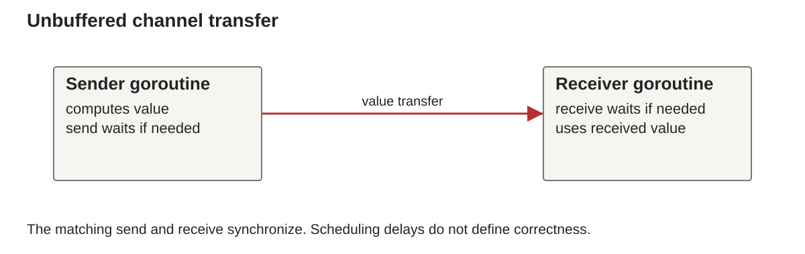

# Week 11: Concurrency I with Go

BS0030 Programming Languages, Fall 2026

## Continuity

Kotlin objects organized state. Concurrent execution makes access to that state a coordination problem.

## Concurrency I with Go

Week 11, BS0030 Programming Languages

**Independent progress requires explicit coordination.**

## Concurrency and parallelism

- **Concurrency:** computations can progress independently.
- **Parallelism:** computations execute at the same time.

A single processor can interleave concurrent tasks.
Several processors may execute them in parallel.

## Learning outcomes

- Read basic Go functions and explicit error returns.
- Start goroutines and coordinate their completion.
- Use channel sends and receives.
- Diagnose a race and a deadlock.
- Explain who owns a channel's closure and data.

## A minimal Go program

```go
package main
import "fmt"
func square(n int) int { return n * n }
func main() {
    n := 3
    fmt.Println(square(n))
}
```

`:=` declares and initializes local variables.

## Sequential work

```go
values := []int{1, 2, 3}
for _, value := range values {
    fmt.Println(square(value))
}
```

Expected order: 1, 4, 9.

## Starting a goroutine

```go
go square(3)
```

The caller can continue before the function finishes.
This call discards the function's returned value.

A goroutine is not a promise or an OS thread.

## Main does not wait automatically

```go
func main() {
    go fmt.Println("worker")
    fmt.Println("main")
}
```

The worker may never print before the process exits.

## An unbuffered channel

```go
results := make(chan int)
go func() { results <- square(3) }()
answer := <-results
fmt.Println(answer)
```

The send and receive coordinate a transfer.

## Channel communication



Go channels reflect ideas from communicating sequential processes (CSP).
An unbuffered transfer joins a sender and receiver.
No fixed time delay is required.

## A data race

```go
count := 0
go func() { count++ }()
count++
```

Concurrent conflicting accesses lack synchronization.
This example has undefined assumptions about completion too.

## Lost-update illustration

| Step | Task A | Task B |
| --- | --- | --- |
| 1 | reads 0 | |
| 2 | | reads 0 |
| 3 | writes 1 | |
| 4 | | writes 1 |

Two increments can lose an update.

## Coordination choices

| Mechanism | Responsibility |
| --- | --- |
| mutex | protect a shared critical section |
| channel | communicate and synchronize |
| WaitGroup | wait for a known set of tasks |

Pick a mechanism that matches the ownership model.

## One owner of the total

```go
results := make(chan int)
for _, n := range []int{1, 2, 3} {
    go func(x int) { results <- x * x }(n)
}
total := 0
for i := 0; i < 3; i++ { total += <-results }
fmt.Println(total) // 14
```

## Completion order and result order

```go
type Result struct {
    Index int
    Value int
}
```

Attach an index to each result.
The collector can reconstruct input order.

## Closing a channel

```go
go func() {
    for _, n := range []int{1, 2, 3} { results <- n }
    close(results)
}()
for value := range results { fmt.Println(value) }
```

`results` must be created before this excerpt.

## Receiving after closure

```go
value, ok := <-results
```

- `ok=true`: a value was received.
- `ok=false`: the channel is closed and drained.
- A closed, drained `chan int` returns zero and false.

## Closure ownership

- Senders must finish before a channel closes.
- Sending on a closed channel panics.
- Closing an already closed channel panics.
- A receiver usually cannot know all senders have finished.

For several senders, appoint a coordinator.

## A deadlock

```go
ch := make(chan int)
ch <- 1
fmt.Println(<-ch)
```

The send blocks before this goroutine reaches its receive.

## Buffered channels

```go
ch := make(chan int, 1)
ch <- 1
fmt.Println(<-ch)
```

A send proceeds while buffer space is available.
A full buffer can still block the sender.

## A pipeline model

```text
producer: emits inputs
worker: transforms values
collector: combines results
```

Each channel needs a clear sender and termination protocol.

## Explicit errors

```go
func divide(a, b int) (int, error) {
    if b == 0 { return 0, fmt.Errorf("zero divisor") }
    return a / b, nil
}
```

Check the error before using the result.

## Validation for concurrency

```bash
go run main.go
go run -race main.go
go test -race ./...
```

Use deterministic expected results.
The race detector checks executions it actually observes.

## Practical and Week 12

[Week 11 lab](../../labs/week11/README.md)

Compute squares sequentially and with message passing.
Explain deterministic values and unspecified arrival order.

Next: bounded workers, cancellation and channel coordination.

## Further study

- [Go Tour: concurrency](https://go.dev/tour/concurrency/1).
- [Go specification](https://go.dev/ref/spec).
- [Go memory model](https://go.dev/ref/mem).
- [Race detector](https://go.dev/doc/articles/race_detector).
- Sebesta 12e §§13.1–13.5.

Exercise: repair the unbuffered-channel deadlock two ways.

## Further reading in Sebesta

Sebesta 12e §§13.1–13.5. Go semantics come from the specification and memory model.

## Next unit

Week 12 extends channels into bounded worker pools, cancellation and complete pipeline lifecycles.
