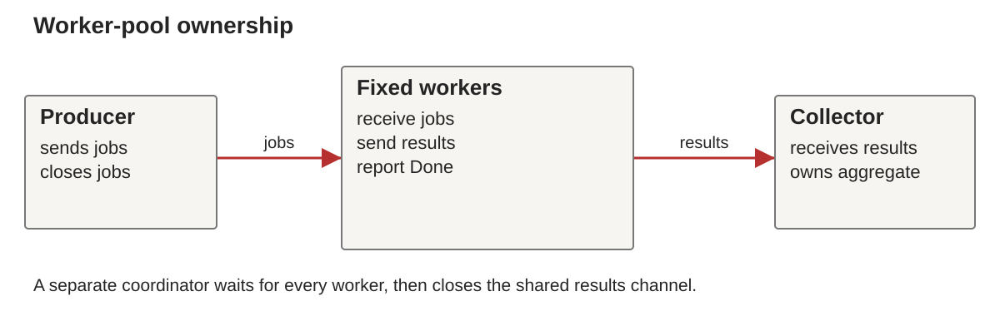

# Week 12: Concurrency II: Coordination and Cancellation

BS0030 Programming Languages, Fall 2026

## Continuity

Week 11 introduced races, goroutines, channels and ownership of communication.

## Concurrency II

Week 12, BS0030 Programming Languages

**Bounded work, cancellation and complete lifecycles**

## Learning outcomes

- Bound active work with a worker pool.
- Coordinate sender completion before closure.
- Use select and context cancellation.
- Separate cancellation requests from completion.
- Compare concurrent and sequential behavior fairly.

## Pipeline ownership



- Producer owns `jobs` closure.
- Coordinator owns `results` closure.
- Collector owns aggregation.

## Bounded work and backpressure

```go
jobs := make(chan int, 4)
results := make(chan int, 4)
```

Three workers bound simultaneous transformations to three.
Buffer capacity bounds queued values on each channel.

## Worker accounting

```go
var wg sync.WaitGroup
wg.Add(workers)
for i := 0; i < workers; i++ {
    go func() {
        defer wg.Done()
        for n := range jobs { results <- n * n }
    }()
}
```

## One coordinator closes results

```go
go func() {
    wg.Wait()
    close(results)
}()
for value := range results { total += value }
```

The collector runs while workers produce results.

## A wait-before-drain deadlock

```text
collector waits for workers
workers wait for result-buffer space
buffer space needs the collector
```

A larger buffer can hide this bug for small inputs.

## Early consumer exit

```go
first := <-results
fmt.Println(first)
// Collector returns without draining the stream.
```

Remaining senders may block indefinitely.
The pipeline needs an early-stop protocol.

## select

```go
select {
case results <- value:
    // transferred
case <-ctx.Done():
    return
}
```

Either a send or cancellation can permit progress.

## Context cancellation

```go
ctx, cancel := context.WithCancel(context.Background())
defer cancel()
```

`cancel()` signals a request to stop.
`ctx.Done()` becomes ready when cancellation is signaled.

## A cancellable receive

```go
select {
case <-ctx.Done():
    return
case n, ok := <-jobs:
    if !ok { return }
    // compute using n
}
```

## A cancellable send

```go
value := n * n
select {
case <-ctx.Done():
    return
case results <- value:
}
```

Every blocking stage needs a way to stop.

## Cancellation and closure

- Cancel requests that producers and workers return.
- The producer still closes its job stream.
- Workers still report completion.
- The coordinator closes results after all workers finish.

Cancellation does not authorize arbitrary channel closure.

## Deadlines and cleanup

```go
ctx, cancel := context.WithTimeout(
    context.Background(), 500*time.Millisecond)
defer cancel()
```

Pass the context to every stage that must observe the deadline.

## Cancellation is not joining

```text
request stop
workers observe stop
workers finish cleanup
coordinator reports completion
```

Wait for completion before declaring the pipeline finished.

## Result messages and errors

```go
type Result struct {
    Index int
    Value int
    Err error
}
```

Choose: fail fast, or collect all item outcomes.

## Fail-fast lifecycle

1. Observe an error result.
2. Request cancellation.
3. Continue waiting for the stream to close.
4. Return the recorded error after cleanup.

Already completed effects may need separate recovery.

## Testing progress

- Empty input must finish with an empty result.
- One worker must handle more inputs than buffer slots.
- Invalid worker count must fail explicitly.
- A cancelled pipeline must shut down.
- Each successful item must appear exactly once.

## Race detection and ownership

```bash
go test -race ./...
```

A sent slice may still share its backing array.
Do not mutate shared data without a defined protocol.

## A fair comparison

- Use identical transformations and inputs.
- Verify equal results before measuring time.
- Exclude setup or include it consistently.
- Repeat measurements and report variation.
- State worker count and available processors.

## CPU work and I/O waits

CPU-bound work needs processing capacity for speedup.
I/O-bound work can benefit from overlapping waits.

Concurrency improves structure and responsiveness
even when elapsed time does not improve.

## A state-owning goroutine

One goroutine can receive requests and own a lending count.
Each request carries a reply channel.

Other goroutines send messages instead of writing the count.

What happens if the owner stops?

## Practical: complete A6

[Week 12 lab](../../labs/week12/README.md)

- Implement a fixed worker pool.
- Document channel and closure ownership.
- Add cancellation and empty-input handling.
- Compare results with the sequential baseline.
- Explain one race and one deadlock repair.

## Week 13 preview

Go: independently progressing goroutines coordinate.

JavaScript: event handlers and queued callbacks
run through a host event loop.

Which computations can block the response to a new event?

## Further study

- [Go pipelines and cancellation](https://go.dev/blog/pipelines).
- [context package](https://pkg.go.dev/context).
- [sync package](https://pkg.go.dev/sync).
- [Channel and select specification](https://go.dev/ref/spec).
- Sebesta 12e §§13.2–13.5.

Exercise: explain why a large buffer can conceal a lifecycle bug.

## Further reading in Sebesta

Sebesta 12e §§13.2–13.5. The official Go pipelines article supplies further practice.

## Next unit

Week 13 contrasts these independently progressing goroutines with event-driven JavaScript callbacks.
