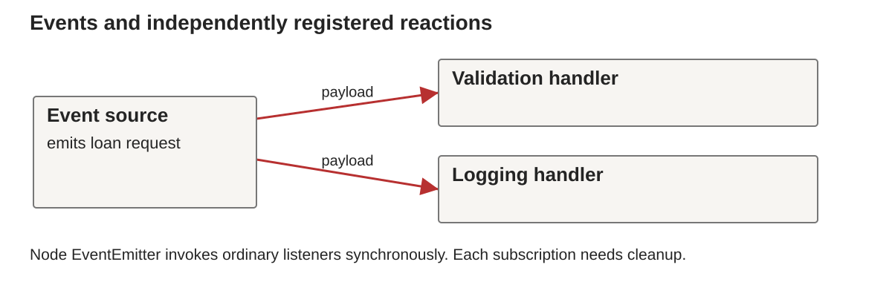

# Week 13: Event-Driven Programming with JavaScript and TypeScript

BS0030 Programming Languages, Fall 2026

## Continuity

Go coordinated independent computations with channels. JavaScript organizes reactions around events and deferred work.

## Event-Driven Programming

Week 13, BS0030 Programming Languages

**JavaScript and TypeScript: reactions, callbacks and scheduling**

## Learning outcomes

- Register and remove event handlers.
- Explain inversion of control and closures.
- Trace synchronous code, microtasks and timers.
- Identify blocking work and callback errors.
- Distinguish TypeScript checking from runtime validation.

## A Node event source

```javascript
const { EventEmitter } = require('node:events');
const bus = new EventEmitter();
bus.on('loan', name => console.log(name));
bus.emit('loan', 'Ada');
console.log('done');
```

Expected output: Ada, then done.

## Inversion of control

```javascript
bus.on('loan', handler);
```

We supply behavior to an event source.
The source chooses when to invoke it.

Registration is different from calling `handler()` now.

## Browser events

```javascript
const button = document.querySelector('#borrow');
button.addEventListener('click', () => {
  console.log('borrow requested');
});
```

Assume the button exists. This runs in a browser, not Node.

## Event-driven architecture



One event may have several subscribers.
Each subscription has a lifecycle.

## Closures in handlers

```javascript
function makeCounter() {
  let count = 0;
  return () => ++count;
}
const next = makeCounter();
console.log(next(), next()); // 1 2
```

## const and object mutation

```javascript
const state = { count: 0 };
state.count += 1;
// state = { count: 2 }; // rejected
```

`const` fixes the binding, not the object's properties.

## Pure core and event shell

```javascript
const allowed = (active, limit) => active < limit;
bus.on('request', ({ active, limit }) => {
  console.log(allowed(active, limit));
});
```

Separate the decision from the event and logging effects.

## Subscription cleanup

```javascript
const handler = name => console.log(name);
bus.on('loan', handler);
bus.off('loan', handler);
```

Removal needs the same function reference.
`once` registers a listener for one invocation.

## Deferred callbacks

```javascript
console.log('A');
setTimeout(() => console.log('B'), 0);
console.log('C');
```

Expected output: A, C, B.

## Run to completion

```javascript
setTimeout(() => console.log('timer'), 0);
const end = Date.now() + 100;
while (Date.now() < end) { /* synchronous work */ }
console.log('finished');
```

The timer callback waits for this work to finish.

## Asynchronous I/O and parallel work

- A host can perform I/O while JavaScript handles other events.
- Long synchronous handlers block that thread.
- Workers can run JavaScript separately.
- `async` syntax alone does not parallelize CPU work.

## Microtasks and timers

```javascript
console.log('A');
queueMicrotask(() => console.log('M'));
setTimeout(() => console.log('T'), 0);
console.log('B');
```

Expected output: A, B, M, T.

## Microtask starvation

```javascript
function again() { queueMicrotask(again); }
// again(); // intentionally not executed
```

An endless microtask chain can delay timers and other work.

## Callback errors

```javascript
setTimeout(() => {
  try { throw new Error('failure'); }
  catch (error) { console.log(error.message); }
}, 0);
```

An outer try around timer registration does not catch this throw.

## Error-first callbacks

```javascript
const fs = require('node:fs');
fs.readFile('data.txt', 'utf8', (error, text) => {
  if (error) { console.error(error.message); return; }
  console.log(text);
});
```

The callback receives the eventual outcome.

## Dependent callbacks

```javascript
loadMember(id, (err, member) => {
  if (err) return report(err);
  loadLoans(member.id, (err, loans) => {
    if (err) return report(err);
    display(member, loans);
  });
});
```

This is API-shaped pseudocode.

## JavaScript dynamic typing

```javascript
let value = 3;
value = 'three';
console.log(typeof value); // string
```

Types belong to runtime values.
Bindings can refer to values of different types.

## Coercion and comparison

```javascript
console.log('3' + 1);  // 31
console.log('3' == 3); // true
console.log('3' === 3); // false
```

Prefer explicit conversion and intentional comparison rules.

## TypeScript event data

```typescript
type LoanRequest = { memberId: number; bookId: number };
function describe(request: LoanRequest): string {
  return `${request.memberId}:${request.bookId}`;
}
// describe({ memberId: 'Ada', bookId: 1 }); // rejected
```

## Type erasure and validation

TypeScript annotations normally disappear from emitted JavaScript.

Untrusted JSON still needs runtime checks.

```typescript
const raw: unknown = JSON.parse(text);
```

Narrow `raw` before using it as a request.

## Discriminated event alternatives

```typescript
type DomainEvent =
  | { kind: 'borrow'; bookId: number }
  | { kind: 'return'; loanId: number };
```

A checked `kind` branch narrows the available fields.

## Practical and Week 14

[Week 13 lab](../../labs/week13/README.md)

- Build a small event bus with cleanup.
- Trace callback order in Node.
- Keep a pure decision function.
- Validate and type event payloads.

Next: promises, async/await and error composition.

## Further study

- [Node events](https://nodejs.org/api/events.html).
- [Node event loop](https://nodejs.org/en/learn/asynchronous-work/event-loop-timers-and-nexttick).
- [TypeScript narrowing](https://www.typescriptlang.org/docs/handbook/2/narrowing.html).
- Sebesta 12e §14.5 and §9.12.

Exercise: explain why an event handler can be synchronous.

## Further reading in Sebesta

Sebesta 12e §14.5 for event handling and §9.12 for closures. JavaScript and TypeScript details require current official references.

## Next unit

Week 14 gives deferred work a composable result representation through promises and async/await.
