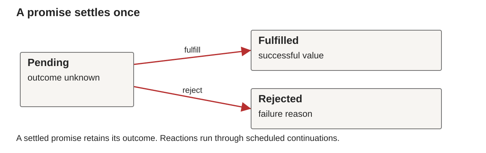

# Week 14: Asynchronous Programming and Paradigm Synthesis

BS0030 Programming Languages, Fall 2026

## Continuity

Week 13 used callbacks and event-loop scheduling. Promises let us compose completion and failure explicitly.

## Asynchronous Programming and Synthesis

Week 14, BS0030 Programming Languages

**Promises, async/await and justified paradigm choices**

## Learning outcomes

- Trace promise chains and async functions.
- Compare dependent and independent operations.
- Handle rejections and cancellation deliberately.
- Distinguish asynchronous work from parallel execution.
- Justify a model using problem constraints and evidence.

## Promise states



A promise settles once, as fulfilled or rejected.
Handlers observe its outcome.

## A predictable ordering trace

```javascript
console.log('A');
Promise.resolve(3).then(x => console.log(x));
console.log('B');
```

Expected output: A, B, 3.

## Chaining values

```javascript
Promise.resolve(3)
  .then(x => x * 2)
  .then(x => console.log(x)); // 6
```

Each `then` returns a new promise.

## Returning dependent work

```javascript
loadMember(id)
  .then(member => loadLoans(member.id))
  .then(loans => display(loans));
```

These helpers represent promise-based APIs.

Omitting the return can detach work from the chain.

## Rejection propagation

```javascript
Promise.resolve(3)
  .then(() => { throw new Error('failed'); })
  .catch(error => console.log(error.message));
```

A thrown handler error rejects the returned promise.

## Recovery is a design decision

```javascript
Promise.reject(new Error('missing'))
  .catch(() => [])
  .then(items => console.log(items.length)); // 0
```

Returning a fallback converts this chain to success.

## async functions return promises

```javascript
async function answer() { return 42; }
console.log(answer() instanceof Promise); // true
```

A thrown exception becomes a rejected promise.

## await

```javascript
async function run() {
  console.log('start');
  const value = await Promise.resolve(42);
  console.log(value);
}
run();
console.log('outside');
```

## Dependent operations

```javascript
const member = await loadMember(id);
const loans = await loadLoans(member.id);
```

The second operation needs the first result.

This excerpt belongs inside an async function.

## Independent operations

```javascript
const memberPromise = loadMember(id);
const booksPromise = loadBooks();
const [member, books] = await Promise.all([
  memberPromise, booksPromise
]);
```

The result array preserves input order.

## Promise.all and failure

`Promise.all` rejects when an input rejects.

Other started operations can continue.
The aggregate does not automatically cancel them.

Use it when all results are required for success.

## Promise.allSettled

```javascript
const results = await Promise.allSettled([
  Promise.resolve(2), Promise.reject(new Error('bad'))
]);
```

Results describe `fulfilled` values or `rejected` reasons.
Their array order matches the input order.

## Bounded asynchronous work

Starting one operation per item may exhaust resources.

Options include:

- sequential work;
- a fixed number of async workers;
- batches when batch-level waiting is acceptable.

## try, catch and finally

```javascript
async function run() {
  try { return await loadData(); }
  catch (error) { console.error(error.message); throw error; }
  finally { console.log('finished'); }
}
```

The caller must still handle a rejected `run()` result.

## A timeout is not cancellation

```javascript
const timeout = new Promise((_, reject) => {
  setTimeout(() => reject(new Error('timeout')), 100);
});
const result = await Promise.race([operation, timeout]);
```

`operation` is an already started promise.

## Cooperative cancellation

```javascript
const controller = new AbortController();
const pending = fetch(url, { signal: controller.signal });
controller.abort();
try { await pending; }
catch (error) { console.log(error.name); }
```

This example requires a URL and a supported host API.

## Stale results

Search A starts, then search B starts.
B completes first, then A completes.

Without a freshness check, A can overwrite B's result.

Use a request identifier or cooperative cancellation.

## Deterministic async tests

- Use local fixtures and controlled failures.
- Test empty input and mixed outcomes.
- Check result ordering separately from completion order.
- Verify cleanup after cancellation.
- Avoid exact elapsed-time assertions.

## Practical: complete A7

[Week 14 lab](../../labs/week14/README.md)

- Refactor callback flow into promises and async/await.
- Handle expected failures without hiding them.
- Compare sequential and bounded overlap.
- Demonstrate cancellation or stale-result protection.
- Explain the event shell and pure core.

## Seven approaches to computation

| Approach | Main abstraction |
| --- | --- |
| imperative | ordered state changes |
| functional | values and functions |
| logic | relations and proof search |
| relational | queries over tables |
| object-oriented | objects and contracts |
| concurrent | independent tasks and communication |
| event-driven / async | reactions and eventual outcomes |

## A design comparison

A library needs:

- monthly borrowing reports;
- constrained staff scheduling;
- validated lending operations;
- responsive search over slow data sources.

Which models fit, and where would you combine them?

## Final-assessment preparation

- Trace unfamiliar code using known concepts.
- Explain one submitted assignment in depth.
- Repair a small defect and justify the change.
- Compare models under explicit constraints.

[Final preparation guide](../../assessments/final-preparation.md)

## Further study

- [Using promises](https://developer.mozilla.org/en-US/docs/Web/JavaScript/Guide/Using_promises).
- [async functions](https://developer.mozilla.org/en-US/docs/Web/JavaScript/Reference/Statements/async_function).
- [AbortController](https://developer.mozilla.org/en-US/docs/Web/API/AbortController).
- Sebesta 12e Chapters 13–16 for conceptual comparison.

Exercise: explain one guarantee your chosen model supplies,
and one property that still needs validation.

## Further reading in Sebesta

Sebesta 12e Chapter 14 for errors/events, Chapter 13 for concurrency, §15.11 and Chapter 16 for comparative synthesis.

## Next unit

The final assessment asks for cumulative explanation, modification and justified paradigm choices.
